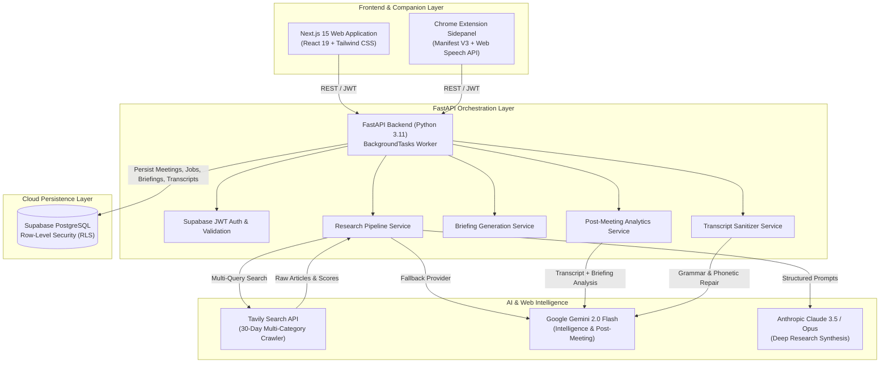

# 🎙️ MeetBrief AI

> **The Autonomous Meeting Lifecycle Companion — Pre-Meeting Deep Research, Real-Time In-Meeting Transcription, and Post-Meeting Intelligence.**

[](https://nextjs.org/)
[](https://react.dev/)
[](https://fastapi.tiangolo.com/)
[](https://python.org/)
[](https://ai.google.dev/)
[](https://anthropic.com/)
[](https://supabase.com/)
[](https://developer.chrome.com/docs/extensions/)
[](https://tailwindcss.com/)

---

## 📌 Executive Summary

Every day, knowledge workers—founders, sales executives, consultants, investors, and engineers—spend hours manually researching meeting participants, furiously taking notes during calls, and struggling to synthesize action items and follow-ups.

**MeetBrief AI** is a full-stack, autonomous meeting intelligence platform designed to transform the entire meeting lifecycle into a seamless, high-leverage experience:

1. **Before the Meeting (Strategic Briefing)**: Autonomous multi-query web research scans news, funding, executive moves, product updates, and partnerships over the trailing 30 days, compiling an executive intelligence dossier in seconds.
2. **During the Meeting (In-Meeting Companion)**: A Manifest V3 Chrome Extension sidepanel auto-detects Google Meet, Zoom, or Teams, providing live, low-latency speech-to-text transcription and elapsed-time tracking.
3. **After the Meeting (Post-Meeting Intelligence)**: Advanced LLMs analyze the transcript alongside the pre-meeting briefing to assess reality vs. expectations, extract owners and action items, identify unresolved questions, and generate a polished, ready-to-send follow-up email.

---

## 🎯 The Problem & Our Solution

| The Challenge | How MeetBrief AI Solves It |
| :--- | :--- |
| **Pre-Meeting Blindspots:** Scrambling 5 minutes before a call to Google a prospect or partner leads to generic conversations and missed opportunities. | **Autonomous 30-Day Research Engine:** Multi-angle web crawler scrapes verified news, press releases, leadership hires, and funding events, synthesizing an executive briefing with citations. |
| **Distracted Note-Taking:** Splitting focus between listening, conversing, and typing notes hurts active engagement and executive presence. | **Ambient Chrome Sidepanel Companion:** Lives directly inside Google Meet, Zoom, and Teams with automatic platform detection, capturing real-time transcript segments. |
| **Unreliable Post-Meeting Follow-Through:** Action items get buried, commitments are forgotten, and follow-up emails take hours to draft. | **Post-Meeting Intelligence & Auto-Email:** Instant extraction of prioritized tasks (with owners & deadlines), decisions, unresolved queries, and a one-click copyable follow-up email. |
| **Lack of Contextual Continuity:** Meeting notes rarely tie back to the initial goals or research context. | **Anticipated vs. Actual Reality Check:** Compares what pre-meeting research anticipated against what was actually discussed to spotlight surprises and confirmed intel. |

---

## 🚀 Key Features

### 1. 🔍 Autonomous Pre-Meeting Research Dossier
* **Multi-Category Trailing 30-Day Search:** Leverages the **Tavily Search API** to query 5 critical corporate axes:
  * 📰 *News & Announcements* (press releases, public statements)
  * 💰 *Funding & Valuation* (rounds raised, investors, valuations)
  * 🚀 *Product & Innovation* (launches, major updates, features)
  * 👥 *Leadership & Executive Moves* (CEO/founder announcements, appointments)
  * 🤝 *Partnerships & M&A* (strategic deals, acquisitions, mergers)
* **Intelligent Relevance Filtering & Deduplication:** Cleans and filters articles published strictly within the meeting research window (30-day cutoff).
* **Structured Executive Briefing:** Powered by **Claude Opus / 3.5** or **Google Gemini 2.0 Flash**:
  * **Executive Snapshot:** High-level executive overview with confidence rating.
  * **Key Developments:** Ranked recent events with direct source links.
  * **Key People & Background:** Bios and contextual relevance to your objective.
  * **Company Insights & Industry Momentum:** Competitive landscape analysis.
  * **Strategic Discussion Points:** Tailored conversation topics.
  * **High-Impact Questions:** Smart questions aligned with your stated objective.
  * **Opportunities & Risk Radar:** Potential landmines and strategic opportunities.
  * **Meeting Strategy:** Concrete guidance on how to navigate the conversation.

### 2. 🎙️ In-Meeting Chrome Companion (Manifest V3)
* **Automatic Platform Detection:** Content scripts instantly recognize when you enter a **Google Meet** (`meet.google.com`), **Zoom** (`zoom.us`), or **Microsoft Teams** (`teams.microsoft.com`) session.
* **Sidepanel Integration:** Operates natively in Chrome's side panel API without blocking video or shared screens.
* **Live Speech-to-Text Transcription:** Captures real-time meeting dialogue via the browser's native Web Speech API with timestamped speaker segments.
* **AI-Powered Transcript Polishing:** Optional LLM cleanup pipeline that fixes misheard phonetic spellings, restores proper punctuation, and capitalizes domain-specific terms without altering conversational meaning.

### 3. 🧠 Post-Meeting Intelligence Engine
* **Anticipated vs. Actual Reality Check:** Evaluates how the conversation diverged from pre-meeting research, highlighting unexpected topics and confirmed assumptions.
* **Structured Decision Log:** Extracts explicit decisions made during the call.
* **Prioritized Action Items:** Automatically classifies tasks into High, Medium, or Low priority with assignees and explicit deadlines.
* **Unresolved Questions Tracker:** Flags questions that were asked but left unanswered during the meeting.
* **Ready-to-Send Follow-up Email:** Generates a professional, context-rich follow-up email with subject line and body, ready for 1-click clipboard copy.
* **Meeting Effectiveness & Sentiment:** Evaluates overall sentiment and provides a frank score of whether the meeting fulfilled its primary objective.

---

## 🏛️ System Architecture



---

## 💻 Tech Stack

| Layer | Technologies |
| :--- | :--- |
| **Frontend Dashboard** | **Next.js 15.1 (App Router)**, **React 19**, **TypeScript**, **Tailwind CSS**, Radix UI Primitives, Lucide React, Sonner Toasts |
| **Backend API** | **FastAPI (0.115+)**, **Python 3.11+**, Uvicorn, Pydantic v2 Settings, BackgroundTasks, Python-Jose |
| **Chrome Extension** | **Manifest V3**, Chrome Side Panel API, Content Scripts, Background Service Worker, Web Speech API |
| **AI & LLM Services** | **Google Gemini 2.0 Flash** (`google-genai`), **Anthropic Claude Opus 4.5 / 3.5 Sonnet** (`anthropic`) |
| **Search & Web Intelligence** | **Tavily Search API** (`tavily-python`) with advanced 30-day temporal filtering |
| **Database & Auth** | **Supabase** (PostgreSQL, Row Level Security, Supabase SSR, JWT Authentication) |

---

## 📂 Repository Structure

```text
MeetBrief-Ai/
├── backend/                        # FastAPI Python backend
│   ├── app/
│   │   ├── api/routes/             # API endpoints
│   │   │   ├── meetings.py         # Meeting CRUD & listings
│   │   │   ├── research.py         # Tavily research trigger & status
│   │   │   ├── briefings.py        # Briefing retrieval
│   │   │   ├── transcripts.py      # Transcript persistence & AI cleanup
│   │   │   └── post_meeting.py     # Post-meeting intelligence pipeline
│   │   ├── core/                   # Auth, database client, settings config
│   │   ├── models/schemas.py       # Pydantic v2 validation models
│   │   └── services/               # Core business logic & AI pipelines
│   │       ├── briefing_service.py # Claude & Gemini briefing prompts & repair
│   │       ├── post_meeting_service.py # Post-call analytics & follow-up email
│   │       └── research_service.py # Multi-category Tavily crawler
│   ├── main.py                     # FastAPI application entrypoint
│   └── requirements.txt            # Python dependencies
├── extension/                      # Manifest V3 Chrome Extension
│   ├── background/
│   │   └── service-worker.js       # Background service worker & sidepanel handler
│   ├── content/
│   │   └── meeting-detector.js     # Detects Google Meet, Zoom, and Teams
│   ├── sidepanel/                  # Extension side panel UI
│   │   ├── sidepanel.html          # Recording interface & meeting picker
│   │   ├── sidepanel.css           # Modern dark/light styling
│   │   └── sidepanel.js            # Web Speech API recorder & backend sync
│   ├── icons/                      # Extension iconography & generator
│   └── manifest.json               # Manifest V3 configuration
├── frontend/                       # Next.js 15 web application
│   ├── app/
│   │   ├── (auth)/login/           # Supabase auth login / signup page
│   │   ├── (dashboard)/            # Authenticated dashboard views
│   │   │   ├── meetings/           # Meeting list & new meeting modal
│   │   │   └── meetings/[id]/      # Meeting dossier, findings & post-meeting tab
│   │   └── page.tsx                # High-conversion landing page
│   ├── components/                 # Reusable UI components
│   │   ├── briefing/               # Structured briefing dossier cards
│   │   ├── meetings/               # Meeting forms, findings, post-meeting views
│   │   └── layout/                 # Sidebar navigation & header
│   └── lib/                        # Supabase SSR client & API fetch wrappers
├── supabase/
│   └── migrations/                 # PostgreSQL schemas & Row Level Security
│       ├── 001_initial_schema.sql  # Meetings, research jobs, findings, briefings
│       └── 002_meeting_companion.sql# Transcripts & post-meeting summaries
├── .env.example                    # Environment variable template
└── SETUP.md                        # Quickstart instructions
```

---

## ⚡ Quickstart Guide

### Prerequisites
- **Node.js**: v20.x or higher
- **Python**: v3.11 or higher
- **Supabase Account**: A free Supabase project
- **AI Keys**: [Anthropic Console](https://console.anthropic.com/) key and/or [Google AI Studio](https://aistudio.google.com/) Gemini key
- **Search Key**: [Tavily AI](https://tavily.com/) Search API key

---

### 1. Database Setup (Supabase)
1. Go to your [Supabase Dashboard](https://supabase.com/dashboard) → **SQL Editor**.
2. Run the migration scripts in sequential order:
   - Run `supabase/migrations/001_initial_schema.sql` (Creates meetings, research jobs, findings, briefings + RLS).
   - Run `supabase/migrations/002_meeting_companion.sql` (Creates transcripts, meeting summaries + RLS).

---

### 2. Environment Configuration
Create a `.env` file in the project root:

```env
# -----------------------------------------------------------------
# SUPABASE CONFIGURATION
# -----------------------------------------------------------------
NEXT_PUBLIC_SUPABASE_URL=https://your-project-ref.supabase.co
SUPABASE_URL=https://your-project-ref.supabase.co
NEXT_PUBLIC_SUPABASE_ANON_KEY=your-supabase-anon-or-publishable-key
SUPABASE_SERVICE_ROLE_KEY=your-supabase-service-role-key
SUPABASE_JWT_SECRET=your-supabase-jwt-secret

# -----------------------------------------------------------------
# AI PROVIDER KEYS (Configure at least one)
# -----------------------------------------------------------------
ANTHROPIC_API_KEY=sk-ant-api03-...
ANTHROPIC_MODEL=claude-opus-4-5

GEMINI_API_KEY=AIzaSy...
GEMINI_MODEL=gemini-2.0-flash

# -----------------------------------------------------------------
# SEARCH ENGINE
# -----------------------------------------------------------------
TAVILY_API_KEY=tvly-...

# -----------------------------------------------------------------
# BACKEND SETTINGS
# -----------------------------------------------------------------
BACKEND_SECRET_KEY=generate-any-random-32-character-secret
ALLOWED_ORIGINS=http://localhost:3000
PORT=8000

# -----------------------------------------------------------------
# FRONTEND SETTINGS
# -----------------------------------------------------------------
NEXT_PUBLIC_API_URL=http://localhost:8000
NEXT_PUBLIC_APP_URL=http://localhost:3000
```

---

### 3. Backend Setup (FastAPI)

```bash
cd backend

# Create and activate a Python virtual environment
python -m venv .venv

# Windows:
.venv\Scripts\activate
# macOS/Linux:
source .venv/bin/activate

# Install dependencies
pip install -r requirements.txt

# Start the development server
uvicorn main:app --reload --port 8000
```
* Backend API: `http://localhost:8000`
* Interactive OpenAPI Docs: `http://localhost:8000/docs`

---

### 4. Frontend Setup (Next.js)

```bash
cd frontend

# Install npm packages
npm install

# Run the Next.js development server
npm run dev
```
* Open `http://localhost:3000` in your browser.

---

### 5. Chrome Extension Setup

1. Open **Google Chrome** and navigate to `chrome://extensions`.
2. Toggle on **Developer mode** in the top right corner.
3. Click **Load unpacked** and select the `extension/` folder from this repository.
4. *(Optional icon generation)*: If icons are missing, open `extension/icons/generate-icons.html` in Chrome and click **Generate & Download Icons** to save them into `extension/icons/`.
5. Pin the **MeetBrief AI Companion** to your Chrome toolbar.

---

## 🔄 End-to-End Walkthrough

```text
1. Schedule & Prepare
   └── In Next.js (localhost:3000): Click "+ New Meeting" → Enter "Stripe", meeting objective, and date.
   └── Click "Prepare Briefing" → The Tavily background pipeline crawls the web for recent events.
   └── In ~45s, a complete strategic briefing appears with key developments, bios, and talking points.

2. Attend & Transcribe
   └── Launch Google Meet, Zoom, or Microsoft Teams.
   └── The MeetBrief AI Chrome Extension sidepanel auto-opens.
   └── Select your meeting from the dropdown and click "Start Recording".
   └── Watch the real-time transcript stream as you speak.

3. Conclude & Follow Up
   └── When the call wraps, click "Stop Recording" in the extension.
   └── Click "Generate Post-Meeting Intelligence".
   └── Instantly view extracted decisions, prioritized action items, and a ready-to-send follow-up email.
```

---

## 📡 API Reference Overview

| Method | Endpoint | Description |
| :--- | :--- | :--- |
| `GET` | `/api/meetings` | List all meetings for the authenticated user |
| `POST` | `/api/meetings` | Create a new meeting |
| `GET` | `/api/meetings/{id}` | Get meeting details including research job status and briefing |
| `DELETE`| `/api/meetings/{id}` | Delete a meeting and all cascading data |
| `POST` | `/api/research/start/{id}` | Launch asynchronous Tavily web research and LLM briefing synthesis |
| `GET` | `/api/research/status/{job_id}` | Poll background research job status (`pending`, `running`, `completed`, `failed`) |
| `GET` | `/api/research/findings/{id}` | Retrieve raw deduplicated web findings with relevance scores & URLs |
| `GET` | `/api/briefings/{id}` | Retrieve synthesized structured executive briefing |
| `POST` | `/api/transcripts` | Save audio transcript segments and full text from Chrome Extension |
| `POST` | `/api/transcripts/cleanup` | Correct phonetic errors & punctuation in transcripts via Gemini 2.0 |
| `POST` | `/api/post-meeting/generate/{id}`| Generate post-meeting summary, decisions, action items, and follow-up email |
| `GET` | `/api/post-meeting/{id}` | Fetch stored post-meeting intelligence |

---

## 🛡️ Security, Privacy & Data Integrity

- **Row Level Security (RLS)**: Every single table in the Supabase PostgreSQL database enforces strict RLS policies: `auth.uid() = user_id`. No user can access or query another user's meetings, briefings, or transcripts.
- **Microphone Consent Compliance**: The extension enforces clear user consent disclosures prior to recording audio.
- **Source Attribution & Grounding**: The briefing prompt strictly instructs the LLM never to hallucinate facts and to cite every development directly to discovered URLs from the last 30 days.
- **Fail-Safe JSON Recovery**: The backend implements intelligent JSON parsing with automatic truncation repair in case of response cutoffs.

---

## 🗺️ Future Roadmap

- [ ] **Calendar Synchronization**: Bidirectional integration with Google Calendar and Outlook 365 to automatically schedule briefings 1 hour before every call.
- [ ] **Dual-Audio Capture**: Chrome tab audio capture to transcribe both incoming and outgoing audio tracks with multi-speaker diarization.
- [ ] **In-Meeting Live Copilot**: Real-time objection handling and context hints displayed in the sidepanel during active conversations.
- [ ] **CRM Auto-Sync**: 1-click sync of action items and summaries into HubSpot, Salesforce, and Notion.

---

## 👥 Hackathon Submission

* **Project Name**: MeetBrief AI
* **Category**: AI Productivity & Developer Tools / LLM Applications
* **Built With**: Next.js 15, FastAPI, Google Gemini 2.0 Flash, Claude, Supabase, Tavily AI, Chrome Extension API

*Empowering professionals to never walk into a meeting unprepared again.* 🚀
